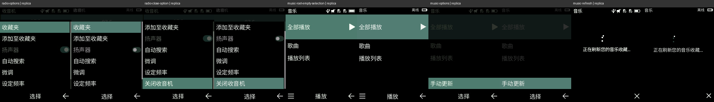

# App page corrections — 2026-10-27

This follow-up checks existing captures before adding behavior. It fixes the radio and music discrepancies below. It does not claim complete application or firmware reconstruction.

## Corrected

- **Radio options:** retained screenshots show a bottom popup over a dimmed radio, not a separate full-screen list. The page now uses the shared popup control, scrolls to Close, fills the gap above the softkeys and preserves the current frequency on cancel. Text now matches 添加至收藏夹 and 设定频率. The speaker row has its switch marker and is disabled: it is grey in the references and the replica has no FM output route. The switch's saved value is local state, not copied from the handset. The native condition that enables the speaker is unknown.
- **Music library menu:** 手动更新 is a one-row popup over the dimmed library. The former full-page 选项 screen and 手动刷新 caption were incorrect.
- **Music refresh:** displays the observed waiting caption and right-side Close symbol. The old library cannot start a track or repeat the refresh while this page is active. Close returns to the library; the local worker continues in the background, and playback remains blocked until the scan finishes. Exact native cancellation of the scanning service is not known. The three-dot animation is local, not an extracted animation.
- **Shared UI:** the existing list popup now owns the blank strip above the softkeys and supports overflow scrolling and a switch marker. Radio's page renderer is separate from its input handler; its base geometry is reused beneath the popup. Rounded control painting moved into Canvas instead of being copied between apps.

## Evidence and limits

[Verification script](../scripts/check-app-page-evidence.py) checks the source SHA-256, two descriptors and fifteen retained PNG hashes. [Evidence](evidence/app-page-evidence.json), [bounded disassembly](evidence/app-page-handlers-thumb.txt).

`FM_OPTION_WIN_ID` is at user-image offset `0x225e40`, handler `0x88591653`. Its left softkey is empty and center is Select. `MMIMP3_LOAD_WAIT_WIN_ID` is at `0x229d58`, handler `0x88ad6ea5`. These are code/data evidence for distinct native windows; the complete handlers and hardware/service behavior were not reconstructed. Geometry and the refresh Close icon come from the actual captures.

The five pairs below show the retained handset image on the left and the corrected CPU render on the right. Status icons, local speaker state, font edges and generated waiting dots can differ. This is not a new physical-phone test or GPU readback.

The stopwatch root/running/single-lap/stopped/reset captures were checked against the implementation. No new contradiction was established for those sampled states; maximum laps, multiple-lap order and scrolling remain unverified. Contacts root/detail menus, calendar options, settings root and personalization were also checked: they already use the retained menu order and shared controls. This does not validate their unsampled subpages. Radio fine-tuning/search and recorder audio remain outside this correction; no new simulated hardware success is reported.

## Configuration follow-up

The owner approved keeping Home, Messages, Contacts, Settings and Files, with other applications optional and enabled by default. [Runtime configuration](config.md) now provides that policy, including menu/shortcut/direct-route gates, service flags, storage selection and reminder suppression without deleting data. This is replica configuration, not recovered native firmware behavior.

## Verification

Default Rust tests, warnings-denied Clippy, formatting, evidence hashes and optimized signed packaging were run. Added tests cover popup background/scroll geometry, radio cancel/close, disabled speaker activation, refresh completion/input gating, configuration defaults/errors/limits, compact menu navigation, shortcut/direct-route blocking and preserved disabled reminders. See [results and hashes](evidence/app-page-corrections-validation.json).

No handset command, sound output, vibration or user-data read was required. The owner later permitted minimal necessary sound, but no output test was needed here. Four opt-in tests remained ignored. The app was not launched into a normal profile; CPU captures and configuration-only CLI checks are not winit visual acceptance. This work is uncommitted.
