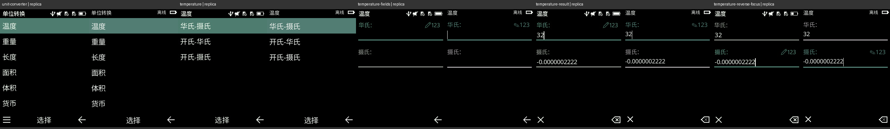

# Utility behavior corrections — 2026-10-27

This pass fixes concrete errors. It does not recover the whole firmware source or claim complete application parity. No handset commands, sound, vibration or real messages were used. The existing repository remains in place.

## Unit converter

The old page skipped the pair submenu, started with `0`, used large boxes and changed the units when Up/Down was pressed. Existing physical captures show an initially empty two-field form: Up/Down moves the cursor, with both units and values retained. The corrected route is category → pair → two editable fields, with inline underlines and shared editor/softkey controls.

The firmware supplies 22 fixed pairs: temperature 3, weight 5, length 5, area 5 and volume 4. The replacement uses their original order and rounded factors. It no longer substitutes modern high-precision constants: the actual `32` Fahrenheit capture produces `-0.0000002222` Celsius, which the recovered multiply/divide-plus-offset sequence reproduces.

- Initialized coefficient table: RAM `0x81c47c24`, referenced at `0x88b9d484`.
- Arithmetic and formatting: `0x88b9cf26` onward. Reverse conversion divides by the forward factor; it does not use the adjacent rounded reciprocal string.
- Numeric input: runtime comparison at `0x88b9e4de` limits input to **12 characters**. The child descriptor's capacity of 13 is not the accepted input limit.
- Fixed output uses ten decimals, a bounded copy and trailing-zero removal. Very small values use scientific notation. Exact libc halfway rounding and all exceptional edit/error transitions remain unverified.

Source SHA-256, descriptor hashes, string addresses, factors and bounded disassembly are retained in [converter recovery](evidence/converter-recovery.json) and [code listing](evidence/converter-thumb.txt). The source image is the locally acquired `user.bin`, SHA-256 `8f0db2dc82f9e763cb700c2e5781b7ca7125a4d250f4c075dbec793eb549c1ca`.

The five side-by-side comparisons below put the physical capture on the left and the local CPU render on the right. References: `unit-converter.png`, `temperature.png`, `temperature-fields.png`, `temperature-result.png`, `temperature-reverse-focus.png` under [20261025 captures](handset-samples/20261025/). Text baselines, stable labels, pair selection and field focus were inspected. Status icons differ with local state; the numeric pencil glyph is a substitute. Currency/custom conversion and its root options remain unavailable. Clear-both, sign entry and exceptional editing remain local policies. This is not pixel-identical acceptance or a new winit/Metal window test.



## Calculator percent

The old `%` action immediately divided one number by 100. The firmware instead sets a binary operator: **left number × 100 ÷ right number**. The corrected example is `50 % 200 = 25`.

Operator assignment is at `0x88b911c0`. Dispatch at `0x88b909f4` selects the percent branch at `0x88b90a72`; `vmul.f64` at `0x88b90a98` uses the `100.0` literal at `0x88b90bf4`, then `vdiv.f64` at `0x88b90a9c` divides by the second operand. [Byte checks](evidence/calculator-percent.json) and [bounded listing](evidence/calculator-percent-thumb.txt) preserve this evidence. Zero divisor produces the local error display. Native tiny-denominator thresholds, repeated equals, chaining and complete formatting are not recovered. No physical percent operation was sampled in this pass.

## Reproduce

```sh
python3 scripts/recover-converter.py
python3 scripts/check-calculator-percent.py
cargo fmt --all
TA1278_AUDIT_FRAMES=/tmp/ta1278-utilities cargo test --workspace --locked
cargo clippy --workspace --all-targets --locked -- -D warnings
sh scripts/package-macos.sh
```

The scripts read verified firmware images and regenerate source tables/evidence; they never execute firmware. The default tests do not play sound or connect to the phone. Do not opt into ignored output tests during quiet time. Packaging does not launch the application.

Regression checks cover pair/back navigation, unchanged values on focus movement, editing in either direction, cursor insertion, literal digits, decimal input, rejected letters, the length bound, shared field baselines, percentage arithmetic and division by zero. [Validation and hashes](evidence/utility-behavior-validation.json).
